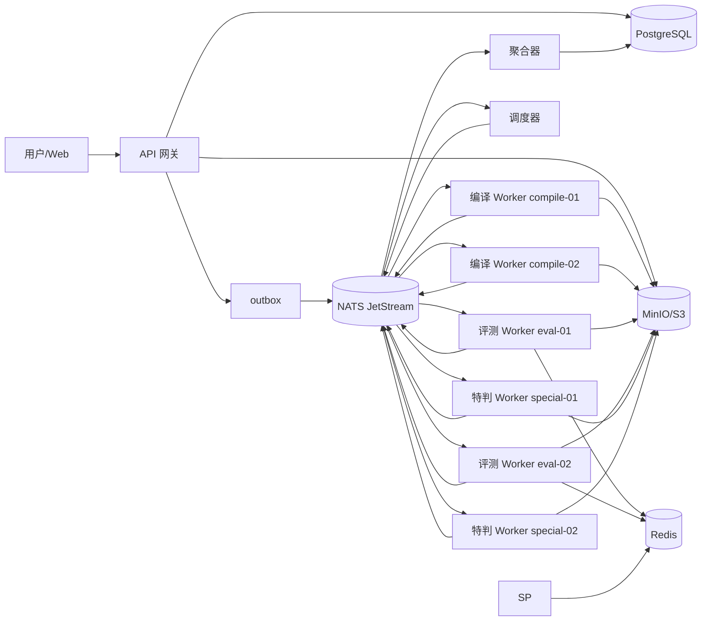

# AlgoOS

面向算法竞赛的轻量分布式评测集群。当前实现按
[实施总案](docs/requirements/distributed_implementation_plan.md) 与
[目标 UML/接口](docs/requirements/next_step.md) 落地，覆盖：

- API 网关、提交/查询/取消/节点/实验接口；
- PostgreSQL 元数据、MinIO/S3 内容寻址、NATS JetStream 六类消息、Redis 心跳与取消快路径；
- 编译 / 评测 / 特判 Worker 池（C++ 执行内核 + Python 队列 Agent，节点数可配置）；
- 统一 `classify()`、cgroup v2 / namespace / seccomp / rlimit / 只读根沙箱适配；
- 有序短路、取消广播、特判回传与 fallback、失联节点重派、本地缓存；
- FCFS / SJF / Aging-SJF / Earliest-Finish / Cache-aware 调度，离散事件模拟与模拟退火放置；
- Web 演示、CLI、Compose/systemd/cloud-init/KVM 部署资产与实验运行器。

> 详细部署与自测步骤见 [deployment.md](deployment.md)。
>
> **验证边界**：本机已完成真实多进程集群验收；KVM 参考多节点资产已提供但
> **未在本机执行**；生产隔离、真实 cgroup OOM、seccomp 逐 syscall、跨机性能实验仍待目标 VM 验证。
> 不要把本机多进程结果写成跨机或云端结论。

## 当前验收状态

| 阶段 | 状态 | 证据 |
|---|---|---|
| 本机服务、迁移/题包、主要判定 | ✅ 本机通过 | [baseline smoke](artifacts/verification/20261116T082019Z_baseline_smoke/manifest.json) |
| 特判 AC/WA/SE/超时、用户取消、有序短路 | ✅ 本机通过 | [special flow](artifacts/verification/20261116T135655Z_special_flow/manifest.json) |
| 缓存、重复结果、Agent 重启、节点失联重派、特判 fallback | ✅ 本机通过 | [reliability flow](artifacts/verification/20261116T135725Z_reliability_flow/manifest.json) |
| 真实 MinIO + 9 条集成测试 | ✅ 本机通过 | [integration](artifacts/verification/20261116T135504Z_minio_integration/manifest.json) |
| systemd / cloud-init / inventory / KVM 参考多节点 | ◐ 资产已备，未执行 VM | [deploy/](deploy) |
| 真实集群实验、模拟器、SA 放置 | ◐ 小规模可跑 | [experiments/](experiments) |
| 生产隔离、跨机、完整实验矩阵 | ❌ 待目标 VM | [实现状态](docs/status/implementation_status.md) |

当前结论与待办见 [实现状态](docs/status/implementation_status.md) 和
[交接说明](docs/status/handoff.md)。

## 架构



图中 2/2/2 只是本机默认示例，三种 Worker 都可由部署扩成任意数量的池。

一次提交：API 写 `submissions + outbox` → 编译 Worker 消费 `compile.task` → 上传 bin →
调度器按策略与缓存亲和派发 `eval.task.<node>` → 评测 Worker 运行并回传 `eval.result` →
聚合器按 `judge_id` 幂等归并；非 AC 在有序短路模式下发布 `cancel`；特判把 `.out` 上传后
交给出题者 checker，结果经 `special.result.<node>` Relay 或 `fallback` 回传。

## 目录

```text
cpp/                 C++23 执行内核、沙箱、编译/评测/特判服务、核心测试
python/              protocol、控制面、节点 Agent、API、CLI、Web、测试
protocol/            policy_v1.json、JSON Schema、golden、fixtures
migrations/          PostgreSQL SQL 迁移
deploy/              compose、systemd、cloud-init、inventory、KVM、脚本
experiments/         真实集群运行器、模拟器、SA 放置、分析
problems/            题目包
examples/            验证程序
scripts/             verification 流程脚本
artifacts/           当前验收证据与实验输出
docs/                需求、设计、运维、状态、规范、记录、报告、归档
```

完整文件树、命名规则、证据命名与删除规则见
[文件结构与命名规范](docs/development/file_structure.md)。

## 快速开始

前置：Linux、g++ 16+、CMake/Ninja、Docker、Python 3.13+、`uv`。

```bash
# 1. Python 依赖与 C++ 构建
uv sync
export PATH="$PWD/.venv/bin:$PATH"
cmake -S cpp -B build/cpp -G Ninja -DCMAKE_BUILD_TYPE=RelWithDebInfo
cmake --build build/cpp --parallel "$(nproc --ignore=4)"

# 2. 核心测试与静态检查
./build/cpp/algoos-core-tests
uv run pytest -q
uv run ruff check python experiments scripts protocol

# 3. 真实本机集群 E2E（Docker + MinIO + 多进程）
PYTHONPATH=python uv run python scripts/verify_special_flow.py --actor "$USER"
PYTHONPATH=python uv run python scripts/verify_reliability_flow.py --actor "$USER"

# 4. pytest 集成测试（真实集群 + MinIO；较慢）
uv run pytest -q -m integration
```

### 本机常驻集群

```bash
cp deploy/compose/.env.example deploy/compose/.env   # 按需改镜像源
deploy/scripts/local_cluster.sh start                # PG/Redis/NATS/MinIO 容器 + 全部进程
# 打开 http://127.0.0.1:8080/
deploy/scripts/local_cluster.sh stop
```

本地脚本默认关闭 cgroup/namespace/seccomp（`ALGOOS_FULL_SANDBOX=1` 可开启完整沙箱）。
S3 默认使用固定 digest 的 MinIO（Chainguard 构建的 AGPLv3 社区版），`algoos doctor`、
真实提交和集成测试都已在该 MinIO 上通过。上游 `minio/minio` 镜像在本环境被 registry
拒绝，`dl.min.io` 的社区二进制返回 410，因此没有使用上游镜像；这不是生产对象存储、
跨机或持久化验收。`ALGOOS_S3_MODE=moto` / `ALGOOS_TEST_S3=moto` 只作为无法拉取 MinIO
时的回退，moto 结果只能写成“S3 兼容测试”，不能写成 MinIO 验证。

### CLI

```bash
uv run algoos import-problems
uv run algoos submit --problem a_plus_b --file examples/a_plus_b.cpp
uv run algoos status <file_id>
uv run algoos cancel <file_id>
uv run algoos nodes
uv run algoos problems
uv run algoos experiment simulation --profile mixed --count 200 --nodes 2
uv run algoos doctor
```

## 实验

```bash
# 真实本机集群固定轨迹
PYTHONPATH=python uv run python -m experiments.runner --count 12 --actor "$USER"

# 离线离散事件模拟（严格标注 simulation）
uv run python -m experiments.simulator.run --profile mixed --count 200 --nodes 2

# 模拟退火副本放置
uv run python -m experiments.placement.run

# Markdown 报告
uv run python -m experiments.analysis.report artifacts/experiments/<run>
```

`manifest.json` 的 `data_source=cluster|simulation` 是唯一口径来源；模拟数据不得写成
集群性能结论。固定负载、策略与 SA 参数见 [experiments/profiles/](experiments/profiles)。

## 部署

- 本机/单机多进程：[deploy/scripts/local_cluster.sh](deploy/scripts/local_cluster.sh)
- systemd：[deploy/systemd/](deploy/systemd)，环境变量模板 [deploy/env.example](deploy/env.example)
- cloud-init / inventory：[deploy/cloud-init/](deploy/cloud-init)、[deploy/inventory/](deploy/inventory)
- KVM 参考多节点：[deploy/kvm/README.md](deploy/kvm/README.md)

KVM 参考多节点拓扑覆盖控制面、编译池、评测池与特判池；当前未在本机执行，
汇报时必须区分“本机多进程”和“KVM/云端”。

## 文档索引

- 完整索引：[docs/README.md](docs/README.md)
- 部署与自测：[deployment.md](deployment.md)
- 需求与目标：[docs/requirements/](docs/requirements)
- 架构设计：[docs/design/distributed_architecture.md](docs/design/distributed_architecture.md)
- 部署运维：[docs/operations/cluster_deployment.md](docs/operations/cluster_deployment.md)
- 实现状态：[docs/status/implementation_status.md](docs/status/implementation_status.md)
- 交接说明：[docs/status/handoff.md](docs/status/handoff.md)
- 文件结构与命名：[docs/development/file_structure.md](docs/development/file_structure.md)
- 开发记录：[docs/records/progress.md](docs/records/progress.md)
- 历史归档：[docs/archive/](docs/archive)

## 提交与验证规范

- conventional commits；每项改动附实际命令与证据。
- 真实运行证据写 `artifacts/verification/` 或 `artifacts/experiments/`；模拟数据写
  `data_source=simulation`，不得混入验收 manifest。
- 测试打包 zip、构建产物、缓存、运行时 `work/` 不入库；任务结束清理。
- 服务器/VM 上的完整隔离、OOM、seccomp 与跨机实验必须在目标环境重新验收，不能仅凭本机
  单测或合成样例声称完成。
