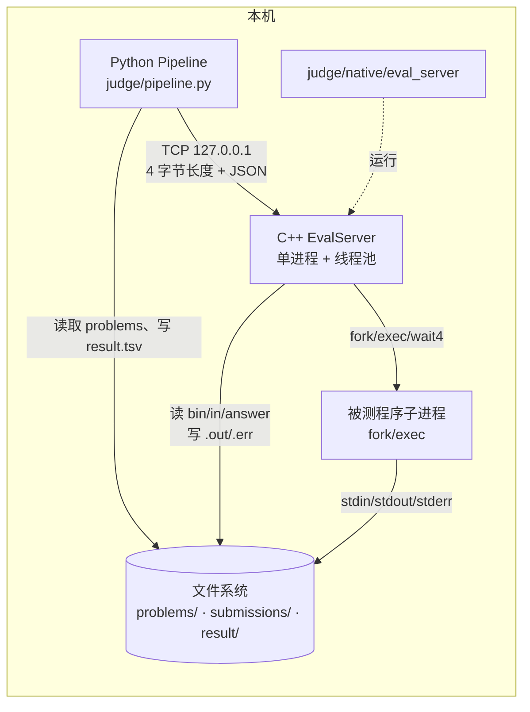
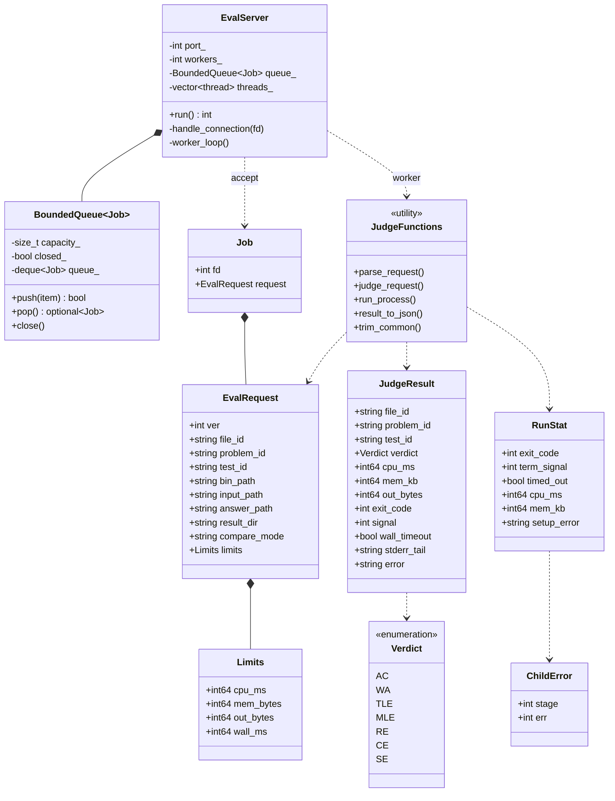
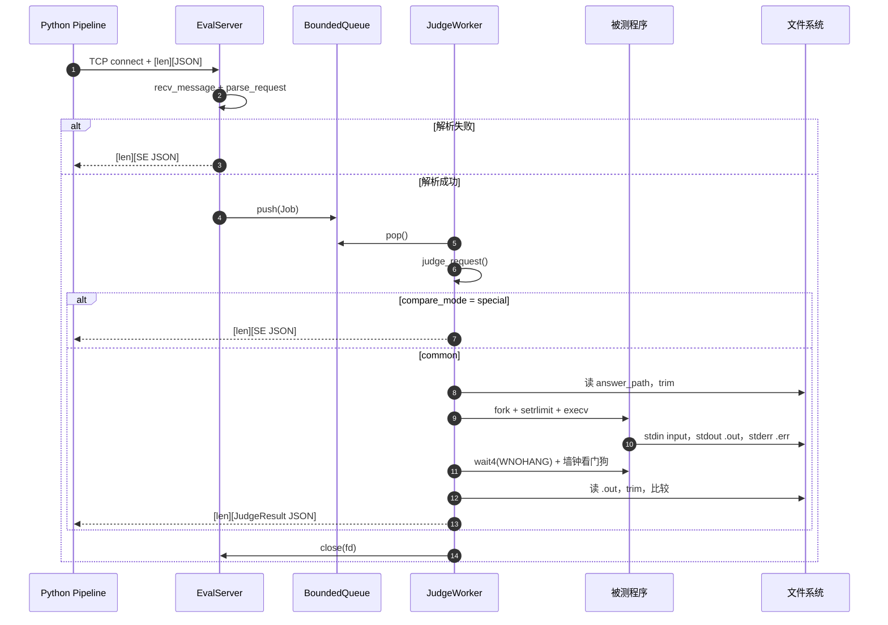
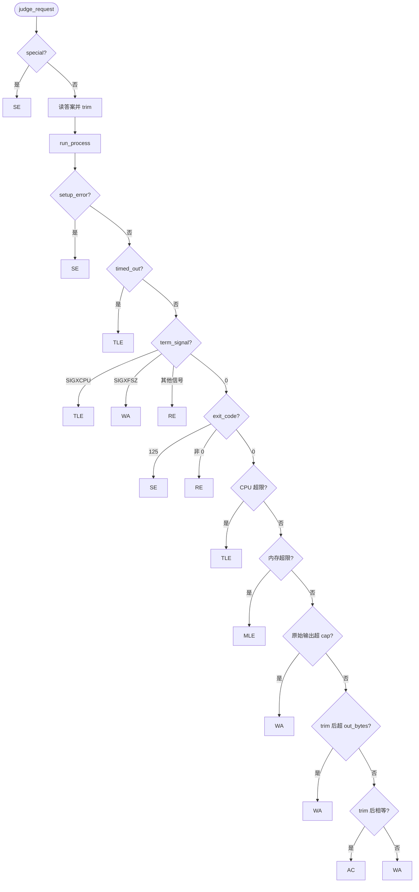

# eval_server.cpp 工作原理

本文说明 [judge/native/eval_server.cpp](../../judge/native/eval_server.cpp) 的运行模型、协议、资源限制、判定流程，以及对应的 UML。部署与操作步骤见 [部署文档](../ops/deployment.md)，协议速查见 [judge/native/README.md](../../judge/native/README.md)。

## 1. 定位与边界

`eval_server` 是一个**单进程、多线程的本地评测服务端**。它不编译代码，只负责“一个测试点”的执行：

- 接收 Python 主控发来的评测请求；
- 在子进程中运行已经编译好的被测程序；
- 施加 CPU、内存、输出文件大小和墙钟限制；
- 读取实际输出，与标准答案比较；
- 返回单测试点 JSON 结果。

它不负责：

- 编译（由 `judge/pipeline.py` 调用 `g++`）；
- 提交级 ACM 聚合（由 Python 完成）；
- `result/result.tsv` 的写入（由 Python 完成）；
- 用户鉴权、TLS、跨机器调度。

默认监听 `127.0.0.1:9000`，默认 4 个 worker、队列容量 64。源码和可执行文件同在 `judge/native/`。

## 2. 语言与系统调用

实现语言是 C++23，使用 POSIX/Linux 接口和 `json-c`：

| 能力 | 使用的接口 |
| --- | --- |
| Socket 服务 | `socket`、`bind`、`listen`、`accept`、`poll`、`send`、`recv` |
| 请求解析/序列化 | `json-c`（`json_tokener_parse`、`json_object_*`） |
| 进程执行 | `fork`、`execv`、`wait4` |
| 资源限制 | `setrlimit`（`RLIMIT_CPU`、`RLIMIT_AS`、`RLIMIT_FSIZE`、`RLIMIT_CORE`） |
| 超时清理 | `kill` + 独立进程组（`setpgid`） |
| 并发 | `std::thread`、`std::mutex`、`std::condition_variable` |
| 文件/路径 | `std::filesystem`、`open`、`dup2`、`read` |

选择 `fork/exec` 而不是线程内直接运行被测程序，是为了让每个测试点拥有独立的进程地址空间、独立的退出状态和可回收的 `rusage`；同时可以在 `exec` 前设置 `rlimit`。

## 3. 进程与线程模型

```text
主线程
  └── poll/accept 循环
        └── 每来一个连接：读取一条长度前缀 JSON
              └── 放入有界队列

N 个 worker 线程
  └── 从队列取 Job
        └── judge_request()
              └── fork/exec 被测程序
              └── wait4 + 墙钟看门狗
              └── 比对 + 生成 JSON 响应
              └── 回写 socket，关闭连接
```

关键点：

- **一条连接只处理一次请求/一次响应**，响应后关闭。
- 主线程同步读取请求；慢客户端会暂时阻塞 accept 循环（当前规模可接受）。
- `BoundedQueue` 满时 `push` 阻塞，形成背压；服务端停止时 `close` 唤醒所有 worker。
- 每个 worker 独立处理一个测试点；多个测试点可以并行。
- 每个测试点对应一个被测程序子进程；子进程设置独立进程组，超时后整组 `SIGKILL`。

## 4. 请求生命周期

1. `handle_connection(fd)` 设置 5 秒收发超时。
2. `recv_message` 读取 4 字节大端长度，再读取 JSON。
3. `parse_request` 校验协议版本、字段、`compare_mode` 和 limits 范围。
4. 解析失败：立即返回 `SE`，不回队列。
5. 解析成功：构造 `Job{fd, request}`，`queue_.push`。
6. worker `pop` 到 Job，调用 `judge_request`。
7. `judge_request` 返回 `JudgeResult`，`result_to_json` 序列化。
8. `send_message` 写回长度前缀 + JSON，关闭连接。

## 5. 协议

帧格式：

```text
Request  = [uint32_be len][JSON]
Response = [uint32_be len][JSON]
```

请求核心字段：

```json
{
  "ver": 1,
  "file_id": "00000001__lazy_gold",
  "problem_id": "lazy_gold",
  "test_id": "1",
  "bin_path": "/abs/submissions/00000001__lazy_gold",
  "input_path": "/abs/problems/lazy_gold/tests/1.in",
  "answer_path": "/abs/problems/lazy_gold/tests/1.out",
  "result_dir": "/abs/submissions/00000001__lazy_gold__result",
  "limits": {
    "cpu_ms": 1000,
    "mem_bytes": 268435456,
    "out_bytes": 1,
    "wall_ms": 1000
  },
  "compare_mode": "common"
}
```

- `compare_mode`：`common` / `special`。
- `wall_ms` 缺省或为 0 时等于 `cpu_ms`。
- `out_bytes` 是 common 的语义输出上限，允许 0。
- `result_dir` 必填；实际输出写 `<result_dir>/<test_id>.out`，stderr 写 `<result_dir>/<test_id>.err`。
- 单条消息上限 1 MiB。

响应核心字段：

```json
{
  "ver": 1,
  "file_id": "00000001__lazy_gold",
  "problem_id": "lazy_gold",
  "test_id": "1",
  "verdict": "AC",
  "cpu_ms": 1,
  "mem_kb": 4000,
  "out_bytes": 1,
  "exit_code": 0,
  "signal": 0,
  "wall_timeout": false,
  "stderr_tail": "",
  "error": ""
}
```

- `cpu_ms`：`wait4` 的 `ru_utime + ru_stime`。
- `mem_kb`：`ru_maxrss`（Linux 下为 KB）。
- `out_bytes`：trim 后实际输出字节数。
- `error`：仅 `SE` 时填写。

## 6. 资源限制

| 字段 | 子进程实现 |
| --- | --- |
| `cpu_ms` | `RLIMIT_CPU`：向上取整到秒 N，软限制 N 秒、硬限制 N+1 秒 |
| `mem_bytes` | `RLIMIT_AS`：虚拟地址空间 |
| `out_bytes` | 语义上限；`RLIMIT_FSIZE` 实际使用 `min(256 MiB, out_bytes + 4 KiB)` 安全 cap |
| `wall_ms` | 父进程 `wait4(WNOHANG)` 轮询 + 超时 `SIGKILL` 进程组 |

补充：

- `RLIMIT_CORE=0`，不生成 core 文件。
- 标准输入重定向到 `input_path`，标准输出/错误重定向到结果目录。
- 安全 cap 与语义上限分离：正确的末尾换行/行尾空格不会在比较前被 `RLIMIT_FSIZE` 误杀；真正超长输出仍会被 cap 或 `SIGXFSZ` 拦下，统一归入 `WA`。
- 答案读取上限 64 MiB；stderr 尾部最多 4 KiB。

## 7. common 比较与 special

### common

1. CRLF/CR → LF。
2. 去掉每行末尾空格/制表符。
3. 去掉文件末尾空行。
4. 与标准答案严格相等 → AC，否则 WA。

标准答案在请求处理开始时读取并 trim；实际输出在子进程结束后读取并 trim。trim 后实际长度超过 `out_bytes` → WA。

### special

本期只保留枚举。`compare_mode=special` 时 `judge_request` 在读取答案之前直接返回：

```text
verdict = SE
error = "compare_mode=special 尚未实现：本期不提供 checker"
```

不会 fork，也不会静默按 common 比较。

## 8. 判定优先级

```text
SE（协议/文件/exec/setrlimit 失败）
 → 看门狗超时 / SIGXCPU / CPU 硬限制 SIGKILL（TLE）
 → SIGXFSZ（WA） / 其他信号（RE）
 → 非零退出（RE）
 → CPU 超限（TLE）
 → 内存超限（MLE）
 → 原始输出超安全 cap（WA）
 → trim 后超 out_bytes（WA）
 → trim 后严格相等（AC / WA）
```

`OLE` 不再单独存在，所有输出超限场景归入 `WA`。

## 9. UML

### 9.1 部署/组件图



### 9.2 类图



### 9.3 一次请求的时序图



### 9.4 判定活动图



## 10. 错误处理与安全

- 子进程的 `pipe` 使用 `FD_CLOEXEC`；`fork` 后子进程只调用 async-signal-safe 的 `open`、`dup2`、`setrlimit`、`setpgid`、`execv`、`write`、`_exit`。
- `exec`/`setrlimit`/重定向失败通过 `ChildError{stage, errno}` 管道回传，父进程映射为 `SE`。
- 不使用 shell，不拼接命令；`argv` 在 `fork` 前构造。
- Socket 只绑定 `127.0.0.1`，没有认证/TLS。
- 请求消息上限 1 MiB；答案读取上限 64 MiB；stderr 尾部 4 KiB。
- 超时后杀整个进程组，避免被测程序留下孙进程。

## 11. 已知限制

- 没有 cgroup / Isolate / namespace 隔离，只有 `rlimit` 和进程组清理。
- `ru_maxrss` 与 `RLIMIT_AS` 的口径不同：分配失败可能先表现为 `RE`，MLE 归类仍由上层策略决定。
- `special` checker 未实现，返回 `SE`。
- 主线程同步读取请求，慢客户端会阻塞 accept；当前规模可接受。
- 没有请求持久化、断线重试、跨重启队列。
- `stderr` 也受 `RLIMIT_FSIZE` 约束；大量调试输出可能提前触发 `WA`。

## 12. 关键函数索引

| 函数 | 作用 |
| --- | --- |
| `parse_request` | JSON → `EvalRequest`，校验协议与 limits |
| `parse_limits` | 解析并默认化 `wall_ms`，校验范围 |
| `judge_request` | 单测试点主流程：special/答案/运行/判定/比对 |
| `run_process` | `fork/exec/wait4`、重定向、rlimit、墙钟看门狗 |
| `trim_common` | common 比较的 trim |
| `result_to_json` | `JudgeResult` → JSON |
| `send_message` / `recv_message` | 长度前缀帧收发 |
| `EvalServer::run` | 监听、accept、worker 生命周期 |
| `EvalServer::worker_loop` | 队列消费与响应回写 |
