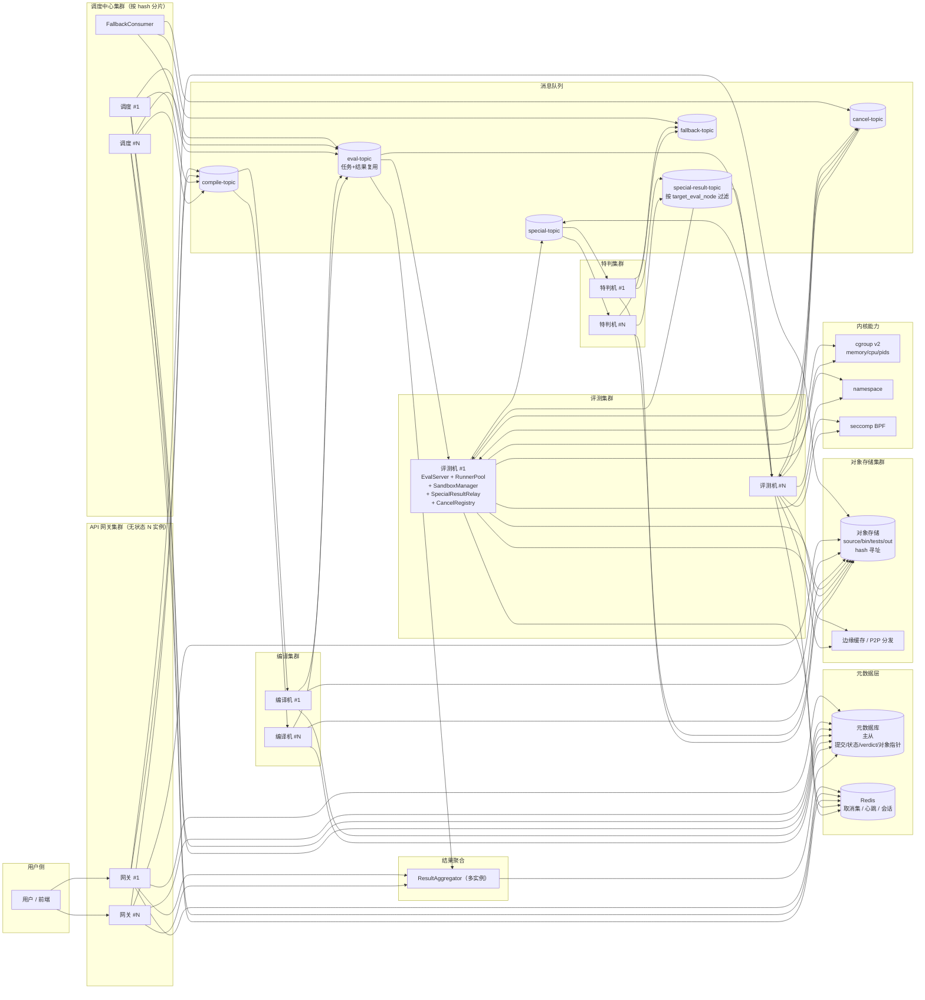
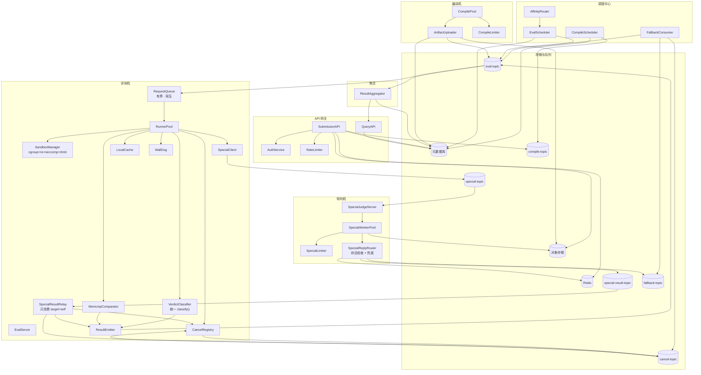
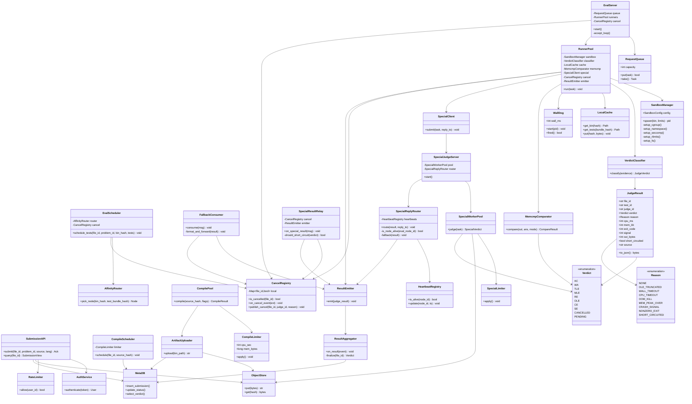
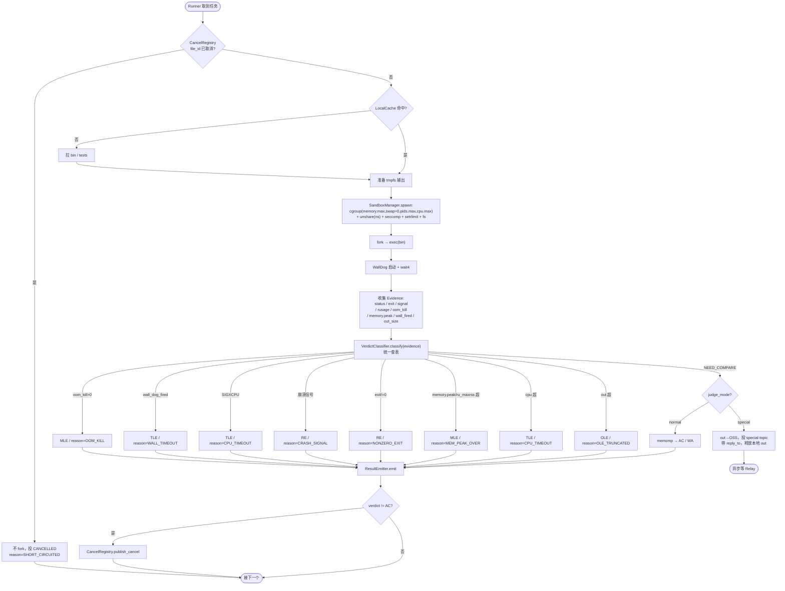
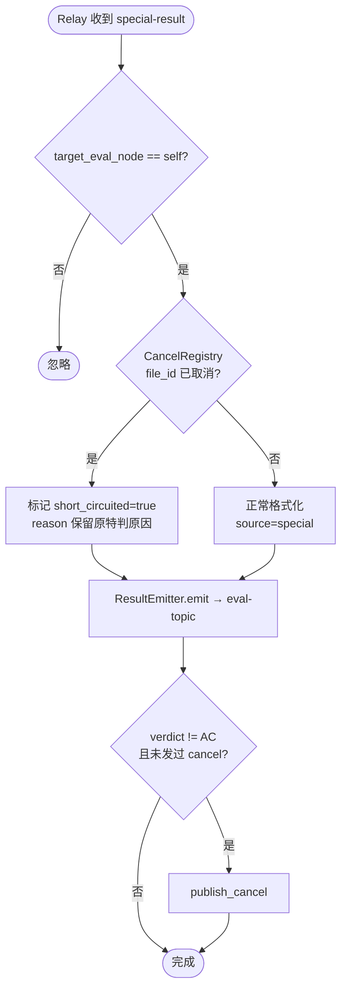
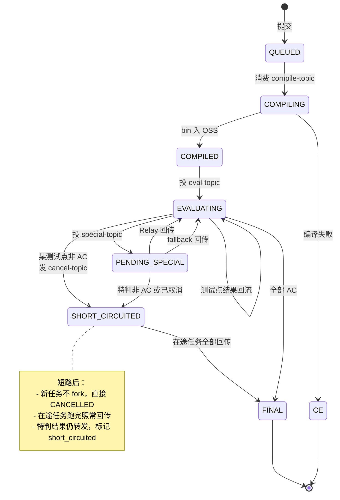

# 完整 UML 与接口规范

以下是整合沙箱、cgroup、短路、特判回传、统一 `classify()`、`verdict + reason` 两级判定后的完整设计。

---

## 1. 部署图



---

## 2. 组件图



---

## 3. 时序图：一次提交完整链路

```mermaid
sequenceDiagram
    autonumber
    actor U as 用户
    participant GW as API 网关
    participant DB as 元数据库
    participant OSS as 对象存储
    participant Q1 as compile-topic
    participant C as 编译机
    participant Q2 as eval-topic
    participant E as 评测机
    participant SBX as SandboxManager
    participant CLS as VerdictClassifier
    participant Q3 as special-topic
    participant SP as 特判机
    participant Q4 as special-result-topic
    participant Q5 as cancel-topic
    participant SRL as SpecialResultRelay
    participant AG as 聚合器

    Note over U,OSS: 阶段 1：提交
    U->>GW: POST /submissions {problemID, source}
    GW->>OSS: put source → source_hash
    GW->>DB: INSERT submission(status=QUEUED, source_hash)
    GW->>Q1: 投编译任务(fileID, source_hash, problemID)
    GW-->>U: 202 {fileID, status=QUEUED}

    Note over Q1,C,OSS: 阶段 2：编译
    Q1->>C: 消费编译任务
    C->>OSS: get source_hash
    C->>C: gcc 编译（CompileLimiter）
    alt 编译失败
        C->>DB: UPDATE status=CE, compile_log
        C->>Q2: 投结果事件(fileID, verdict=CE)
    else 编译成功
        C->>OSS: put bin → bin_hash
        C->>DB: UPDATE status=COMPILED, bin_hash
        loop 每个 test_id
            C->>Q2: 投评测任务(fileID, problemID, testID, bin_hash, limits, judge_mode)
        end
    end

    Note over Q2,E,CLS: 阶段 3：评测（统一 classify）
    Q2->>E: 消费评测任务
    E->>E: CancelRegistry 查 file_id 未取消
    E->>E: LocalCache 命中 bin/tests
    E->>SBX: spawn(bin, limits)
    SBX->>SBX: cgroup(memory.max,swap=0,pids.max,cpu.max)<br/>+ unshare(ns) + seccomp + setrlimit
    SBX-->>E: pid
    E->>E: WallDog 启动 + wait4
    E->>CLS: classify(Evidence)
    CLS-->>E: verdict/reason 或 NEED_COMPARE

    alt 资源类 verdict（TLE/MLE/RE/OLE）
        E->>Q2: 结果事件(verdict, reason, cpu, mem)
        E->>Q5: 发 cancel-topic（非 AC）
    else 一般测评
        E->>E: memcmp(out, ans) → AC/WA
        E->>Q2: 结果事件(verdict, source=runner)
        opt 非 AC
            E->>Q5: 发 cancel-topic
        end
    else 特判
        E->>OSS: put out → out_hash
        E->>Q3: 特判任务(reply_to={eval_node, session})
        E->>E: 立即释放本地 out，接下一个任务（不阻塞）
    end

    Note over Q3,SP,Q4: 阶段 4：特判
    Q3->>SP: 消费特判任务
    SP->>OSS: get out_hash / ans_hash
    SP->>SP: 特判逻辑（SpecialLimiter）
    SP->>SP: SpecialReplyRouter 查心跳
    alt 目标评测机存活
        SP->>Q4: 结果(target_eval_node=e7, verdict, reason)
    else 目标评测机下线
        SP->>Q6: 转投 fallback-topic
    end

    Note over Q4,SRL,AG: 阶段 5：Relay 收口 + 聚合
    Q4->>SRL: 只消费 target==self
    SRL->>SRL: 查 CancelRegistry
    SRL->>Q2: 结果事件(source=special, short_circuited)
    opt 非 AC 且未发过 cancel
        SRL->>Q5: 发 cancel-topic
    end
    Q5-->>E: 广播取消 → CancelRegistry 更新
    Q2->>AG: 消费所有结果事件
    AG->>AG: 按 fileID 归并（全 AC 才 AC；否则首个非 AC）
    AG->>DB: UPDATE submission(status=FINAL, verdict)
    U->>GW: GET /submissions/{fileID}
    GW->>DB: SELECT
    GW-->>U: {verdict, per_test[]}
```

---

## 4. 类图



---

## 5. 活动图：Runner 判定（统一 classify）



---

## 6. 活动图：SpecialResultRelay 收口



---

## 7. 状态机图：提交级



---

## 8. 接口格式规范

### 8.1 通用约定

| 项 | 约定 |
|---|---|
| 队列消息 | `4 字节大端长度前缀 + JSON 载荷` |
| JSON 版本 | 所有消息带 `"ver": 1`，字段向后兼容只增不删 |
| 时间单位 | `cpu_ms`/`wall_ms`/`deadline_ms` 为毫秒，`mem_bytes`/`out_bytes` 为字节 |
| 哈希 | `sha256:<hex>`，对象存储路径用裸 hex |
| 消息 ID | `msg_id` 全局唯一，消费端幂等去重 |
| 幂等键 | `judge_id = file_id:test_id:attempt` |

---

### 8.2 HTTP API（用户接口）

**提交**

```
POST /api/v1/submissions
Content-Type: application/json
Authorization: Bearer <token>

{
  "problem_id": "P1001",
  "language": "cpp17",
  "source": "base64(...)",
  "compile_flags": ["-O2"],          // 可选
  "judge_mode_override": null         // 可选，调试用
}
```

**响应 202**

```json
{
  "ver": 1,
  "file_id": "sub_20261103_001",
  "status": "QUEUED",
  "submitted_at": "2026-11-03T10:00:00Z"
}
```

**查询**

```
GET /api/v1/submissions/{file_id}
```

**响应 200**

```json
{
  "ver": 1,
  "file_id": "sub_20261103_001",
  "problem_id": "P1001",
  "status": "FINAL",
  "verdict": "WA",
  "reason": "NONE",
  "compile_log": "",
  "per_test": [
    { "test_id": "1", "verdict": "AC",  "reason": "NONE", "cpu_ms": 120, "mem_kb": 15420, "out_bytes": 1024 },
    { "test_id": "2", "verdict": "WA",  "reason": "NONE", "cpu_ms": 130, "mem_kb": 15800, "out_bytes": 1024 },
    { "test_id": "3", "verdict": "CANCELLED", "reason": "SHORT_CIRCUITED", "cpu_ms": 0, "mem_kb": 0, "out_bytes": 0 }
  ],
  "finalized_at": "2026-11-03T10:00:05Z"
}
```

---

### 8.3 compile-topic 消息

```json
{
  "ver": 1,
  "msg_id": "m_001",
  "file_id": "sub_20261103_001",
  "problem_id": "P1001",
  "source_hash": "sha256:abc...",
  "language": "cpp17",
  "compile_flags": ["-O2", "-std=c++17"],
  "limits": { "cpu_sec": 10, "mem_bytes": 536870912 }
}
```

---

### 8.4 eval-topic 任务消息

```json
{
  "ver": 1,
  "msg_id": "m_002",
  "type": "task",
  "file_id": "sub_20261103_001",
  "problem_id": "P1001",
  "test_id": "3",
  "judge_id": "sub_20261103_001:3:1",
  "bin_hash": "sha256:bin...",
  "test_bundle_hash": "sha256:tests...",
  "judge_mode": "normal",
  "limits": {
    "cpu_ms": 1000,
    "mem_bytes": 268435456,
    "out_bytes": 67108864,
    "wall_ms": 3000
  },
  "compare_mode": "trim_eol",
  "affinity_hint": { "cached_on": ["eval-07", "eval-12"] }
}
```

`judge_mode` 取值：`normal` / `special`。

---

### 8.5 eval-topic 结果事件

评测机、特判机 Relay、FallbackConsumer 共用此格式。

```json
{
  "ver": 1,
  "msg_id": "m_003",
  "type": "result",
  "file_id": "sub_20261103_001",
  "problem_id": "P1001",
  "test_id": "3",
  "judge_id": "sub_20261103_001:3:1",
  "verdict": "WA",
  "reason": "NONE",
  "cpu_ms": 120,
  "mem_kb": 15420,
  "exit_code": 0,
  "signal": 0,
  "out_bytes": 1024,
  "short_circuited": false,
  "source": "runner",
  "detail": ""
}
```

`source` 取值：`runner` / `special` / `fallback`。

**OLE 合并模式示例**（竞赛配置）：

```json
{
  "verdict": "WA",
  "reason": "OLE_TRUNCATED",
  "out_bytes": 67108865,
  "detail": "output exceeded limit 67108864"
}
```

**OLE 独立模式示例**（教学配置）：

```json
{
  "verdict": "OLE",
  "reason": "OLE_TRUNCATED",
  "out_bytes": 67108865,
  "detail": "output exceeded limit 67108864"
}
```

---

### 8.6 special-topic 特判任务

```json
{
  "ver": 1,
  "msg_id": "m_004",
  "file_id": "sub_20261103_001",
  "problem_id": "P1001",
  "test_id": "3",
  "judge_id": "sub_20261103_001:3:1",
  "out_hash": "sha256:out...",
  "ans_hash": "sha256:ans...",
  "judge_mode": "special",
  "limits": { "cpu_ms": 2000, "mem_bytes": 536870912 },
  "reply_to": {
    "eval_node_id": "eval-07",
    "session_id": "sess-abc123",
    "reply_topic": "special-result-topic",
    "deadline_ms": 30000
  },
  "fallback_topic": "fallback-topic"
}
```

---

### 8.7 special-result-topic 特判结果

```json
{
  "ver": 1,
  "msg_id": "m_005",
  "judge_id": "sub_20261103_001:3:1",
  "file_id": "sub_20261103_001",
  "test_id": "3",
  "target_eval_node": "eval-07",
  "session_id": "sess-abc123",
  "verdict": "WA",
  "reason": "NONE",
  "cpu_ms": 45,
  "mem_kb": 8192,
  "source": "special",
  "short_circuited": false,
  "detail": "line 5: expected 42, got 41"
}
```

`target_eval_node` 是过滤键，评测机 `SpecialResultRelay` 只消费 `target_eval_node == self.node_id` 的消息。

---

### 8.8 cancel-topic 取消广播

```json
{
  "ver": 1,
  "msg_id": "m_006",
  "file_id": "sub_20261103_001",
  "judge_id": "sub_20261103_001:2:1",
  "reason": "WA",
  "origin": "eval-07",
  "ts": "2026-11-03T10:00:03Z"
}
```

`reason` 取值：`WA` / `TLE` / `MLE` / `RE` / `OLE` / `SPECIAL_WA`。

---

### 8.9 fallback-topic 兜底

```json
{
  "ver": 1,
  "msg_id": "m_007",
  "judge_id": "sub_20261103_001:3:1",
  "file_id": "sub_20261103_001",
  "test_id": "3",
  "reply_to": { "eval_node_id": "eval-07", "session_id": "sess-abc123" },
  "verdict": "AC",
  "reason": "NONE",
  "source": "special",
  "fallback_reason": "target_eval_node_unreachable"
}
```

---

### 8.10 对象存储路径规范

| 对象 | 路径 | 说明 |
|---|---|---|
| 源码 | `source/{source_hash}.txt` | 按内容哈希去重 |
| 可执行文件 | `bin/{bin_hash}.bin` | `hash = sha256(source + flags + compiler_ver)` |
| 测试数据包 | `tests/{problem_id}/{bundle_hash}.tar` | 打包，避免海量小文件 |
| 特判输出 | `out/{file_id}/{test_id}/{attempt}/{out_hash}.out` | TTL 24h 自动清理 |
| 编译日志 | `logs/compile/{file_id}.log` | TTL 7d |

**内容寻址规则**：所有 `*_hash` 字段在消息里带 `sha256:` 前缀，对象存储路径用裸 hex。

---

### 8.11 元数据库表结构

```sql
-- 提交主表
CREATE TABLE submissions (
  file_id        VARCHAR(64) PRIMARY KEY,
  problem_id     VARCHAR(64) NOT NULL,
  user_id        VARCHAR(64) NOT NULL,
  language       VARCHAR(16) NOT NULL,
  source_hash    CHAR(64)    NOT NULL,
  bin_hash       CHAR(64),
  status         ENUM('QUEUED','COMPILING','COMPILED','EVALUATING',
                      'PENDING_SPECIAL','SHORT_CIRCUITED','FINAL','CE') NOT NULL,
  verdict        ENUM('AC','WA','TLE','MLE','RE','OLE','CE','SE','CANCELLED') ,
  reason         VARCHAR(32),
  compile_log    TEXT,
  submitted_at   DATETIME(3) NOT NULL,
  finalized_at   DATETIME(3),
  INDEX idx_status (status),
  INDEX idx_problem (problem_id)
);

-- 测试点结果表
CREATE TABLE test_results (
  file_id     VARCHAR(64) NOT NULL,
  test_id     VARCHAR(32) NOT NULL,
  judge_id    VARCHAR(128) NOT NULL,
  attempt     INT NOT NULL DEFAULT 1,
  verdict     ENUM('AC','WA','TLE','MLE','RE','OLE','CANCELLED') NOT NULL,
  reason      VARCHAR(32),
  cpu_ms      INT,
  mem_kb      INT,
  out_bytes   INT,
  exit_code   INT,
  signal      INT,
  source      ENUM('runner','special','fallback') NOT NULL,
  short_circuited BOOL NOT NULL DEFAULT FALSE,
  created_at  DATETIME(3) NOT NULL,
  PRIMARY KEY (file_id, test_id, judge_id),
  INDEX idx_file (file_id)
);

-- 评测机心跳
CREATE TABLE eval_nodes (
  node_id      VARCHAR(64) PRIMARY KEY,
  endpoint     VARCHAR(128) NOT NULL,
  last_heartbeat DATETIME(3) NOT NULL,
  cached_hashes JSON,
  load_score   FLOAT,
  INDEX idx_hb (last_heartbeat)
);
```

---

### 8.12 Evidence 与 classify 接口（评测机内部）

```cpp
struct Evidence {
    bool   wifexited;      int exit_code;
    bool   wifsignaled;    int term_sig;
    long   oom_kill;       // cgroup memory.events:oom_kill
    long   memory_peak;    // cgroup memory.peak
    long   ru_maxrss;      // wait4 rusage
    bool   wall_dog_fired;
    long   cpu_ms;         // ru_utime + ru_stime
    long   out_size;
    Limits lim;
};

struct JudgeVerdict {
    Verdict verdict;   // AC/WA/TLE/MLE/RE/OLE/...
    Reason  reason;    // NONE/OOM_KILL/...
    bool    need_compare;
};

JudgeVerdict classify(const Evidence& e);
```

**判定优先级**（`classify` 内部按序查表）：

```
1. oom_kill > 0                          → MLE / OOM_KILL
2. wall_dog_fired                        → TLE / WALL_TIMEOUT
3. WIFSIGNALED && sig == SIGXCPU         → TLE / CPU_TIMEOUT
4. WIFSIGNALED && is_crash_sig(sig)      → RE  / CRASH_SIGNAL
5. WIFEXITED && exit_code != 0           → RE  / NONZERO_EXIT
6. memory_peak > lim.mem_bytes           → MLE / MEM_PEAK_OVER
7. ru_maxrss > lim.mem_bytes             → MLE / MEM_PEAK_OVER
8. cpu_ms > lim.cpu_ms                   → TLE / CPU_TIMEOUT
9. out_size > lim.out_bytes              → OLE / OLE_TRUNCATED
10. 否则                                  → NEED_COMPARE
```

---

## 9. 关键设计对照表

| 关注点 | 落点 | 说明 |
|---|---|---|
| 用户唯一入口 | API 网关（多实例） | 无状态，可水平扩 |
| 元数据 vs 数据 | MetaDB 只存指针，OSS 存二进制 | DB 压力降一到两个数量级 |
| 编译产物 | 编译机直接 `put` OSS + 更新 DB | 不经过终端 |
| 测试数据 | 打包 `tests.tar` + 本地缓存预热 | 评测时不回源、不读 DB |
| 调度解耦 | 6 个 topic 各司其职 | fan-out 由队列承担 |
| 沙箱 | cgroup + namespace + seccomp + rlimit + fs + capability | 五层齐全，计时用 `wait4` rusage 不受影响 |
| MLE | cgroup `memory.max` + `swap.max=0` OOM kill | 到点必杀，与 TLE 对称 |
| 判定统一 | `classify(evidence)` 单一函数 | TLE/MLE/RE/OLE 一条路径 |
| OLE | 独立判定 + `verdict + reason` 两级 | 对外可配合并为 WA |
| 短路 | `cancel-topic` + `CancelRegistry` | 非 AC 即广播，新任务不 fork |
| 特判回传 | `reply_to` + `special-result-topic` + Relay | 评测机收口，短路决策内聚 |
| 兜底 | `SpecialReplyRouter` 查心跳 → `fallback-topic` | 评测机下线不丢结果 |
| 结果聚合 | 独立 `ResultAggregator` | 按 `file_id` 归并，写回 MetaDB |

**一句话**：所有资源类判定在评测机 `classify()` 统一收口，特判结果经 `special-result-topic` 回到发起评测机的 `SpecialResultRelay`，短路通过 `cancel-topic` 全局广播；沙箱五层齐全，cgroup 让 MLE 与 TLE 对称“到点必杀”；OLE 独立判定但对外可用 `verdict + reason` 两级配置合并。