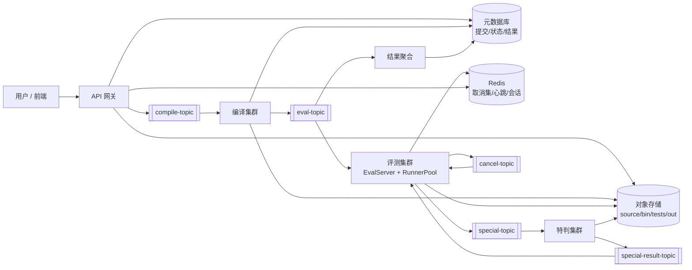

# 中期汇报：轻量级分布式集群的实现与优化

## —— 以 Online Judge 平台为例

日期：2026-11-03

分支：`reroll`

---

## 1. 项目定位与中期目标

本项目面向算法竞赛评测场景，目标是实现一个**轻量级、可水平扩展的分布式评测集群**：用户提交 C++ 源码后，系统完成编译、分发、沙箱运行、输出比对、结果聚合与查询。与通用 OJ 相比，本项目重点关注：

- 评测任务的调度与资源分配；
- 编译、运行、比对、结果聚合的解耦；
- 单机原型到多节点部署的平滑演进；
- 用可解释的实验比较不同调度与放置策略。

中期阶段的目标不是一次性完成完整分布式系统，而是：

1. 先打通**单机可复现评测链路**，形成正确性基线；
2. 明确分布式模块边界、接口和部署方式；
3. 设计可执行的测评方案；
4. 为后续“部署前模拟退火放置优化 + 运行期贪心堆调度优化”准备数据和实验框架。

---

## 2. 已完成成果

### 2.1 单机评测链路

当前已完成一条可运行的单机评测链路：

```text
test_pipeline.py
  → judge/pipeline.py（加载题目、编译、Socket 请求、聚合、result.tsv）
  → judge/native/eval_server（C++ 评测服务端）
  → fork/exec 被测程序
  → RLIMIT_CPU / RLIMIT_AS / RLIMIT_FSIZE + 墙钟看门狗
  → common 输出比对
  → 单测试点 verdict
  → Python ACM 聚合
```

具体实现：

- [test_pipeline.py](test_pipeline.py)：前台常驻入口，加载 `problems/`，监听 `submissions/`，自动启动/停止 C++ 服务端。
- [judge/pipeline.py](judge/pipeline.py)：通用流程，包含编译调度、Socket 客户端、结果聚合、`result.tsv` 写入和轮询。
- [judge/problem.py](judge/problem.py)：`problem.json` 数据模型，派生每个测试点的 `out_bytes`。
- [judge/native/eval_server.cpp](judge/native/eval_server.cpp)：C++23 评测服务端，单进程 + 有界队列 + worker 线程池；每个测试点独立 `fork/exec`。
- [docs/design/eval_server.md](docs/design/eval_server.md)：eval_server 工作原理、协议、资源限制、判定优先级和 4 张 Mermaid UML。

当前评测口径：

- `compare_mode` 只有 `common` / `special`；`special` 本期只保留枚举，返回 `SE`。
- `common`：统一换行，去行末空格/制表符和末尾空行后严格相等。
- 墙钟时限等于 `time_limit_ms`。
- 每个测试点 `out_bytes` 由标准答案 trim 后字节数派生；输出超限归入 `WA`。
- 不使用 score；ACM 聚合：全部测试点 AC 才 AC，否则按顺序取第一个非 AC。

### 2.2 题目与实测结果

当前题目包：

| 题目 | 测试点 | 时限 | 内存 | 比较模式 |
| --- | ---: | ---: | ---: | --- |
| `problems/lazy_gold` | 11 | 1000 ms | 256 MiB | common |
| `problems/sabotage` | 14 | 1000 ms | 256 MiB | common |

实际运行结果见 [result/result.tsv](result/result.tsv)：

- `00000001__lazy_gold.cpp`：AC 11/11；
- `00000002__sabotage.cpp`：AC 14/14；
- `00000003__sabotage.cpp`：RE 0/14，用于验证异常路径。

C++ 服务端已验证：

- AC / WA / TLE / RE / SE 实际跑通；CE 由 Python 编译阶段产生；C++ 实现了 MLE 判定口径，但尚未单独构造验证；
- `fork/exec/wait4`、`RLIMIT_CPU/AS/FSIZE/CORE`、墙钟看门狗；
- 长度前缀 + JSON 协议、线程池、有界队列；
- `result_dir/<test_id>.out/.err` 输出落盘。

### 2.3 工程与文档

已完成：

- 根 [README.md](README.md) 作为总索引；
- [docs/ops/deployment.md](docs/ops/deployment.md)：构建、启动、提交、结果解释和故障排查；
- [docs/specs/stage1_agreement.md](docs/specs/stage1_agreement.md)：字段、路径、结果约定；
- [docs/records/progress.md](docs/records/progress.md)：开发过程记录；
- [docs/archive/2026-11-03_cleanup.md](docs/archive/2026-11-03_cleanup.md)：弃用文件与文档归档记录；
- 题目、提交、结果目录分离：`problems/`、`submissions/`、`result/`、`artifacts/`。

### 2.4 当前边界

必须明确：**当前完成的是单机评测内核和可复现链路，不是完整分布式集群**。

尚未实现：

- API 网关、元数据库、对象存储、消息队列；
- 多评测节点、编译集群、特判集群；
- 分布式调度、节点心跳、故障转移、取消广播；
- cgroup v2 / namespace / seccomp / Isolate 级隔离；
- special judge checker；
- Web 页面与正式用户接口。

这些是下一阶段的设计与实现目标。

---

## 3. 下一步总体路线

建议按“先单机多进程、再多节点、最后优化实验”的顺序推进，避免一开始就引入完整分布式复杂度。

| 阶段 | 时间建议 | 目标 | 验收 |
| --- | --- | --- | --- |
| A. 模块设计 | 11 月上旬 | 明确网关、调度、编译、评测、存储、队列、聚合边界与接口 | 模块图、接口文档、字段表 |
| B. 单机多进程 | 11 月中旬 | Python 主控 + C++ 评测 + 本地队列/存储/DB，打通多进程链路 | 单机多进程可重复评测 |
| C. 多节点部署 | 11 月下旬 | 2—3 个评测节点、共享/对象存储、消息队列、元数据库 | 跨节点分发与结果回流 |
| D. 测评 | 12 月上旬 | 固定 workload、基线对比、性能与正确性统计 | 可复现实验表和图表 |
| E. 优化 | 12 月上旬 | 部署前模拟退火放置 + 运行期贪心堆调度 | 与 FCFS/随机放置对比 |
| F. 收尾 | 12/6 前冻结功能；12/7—13 报告初稿 | 报告、演示、证据归档 | 内部收工 |

---

## 4. 分布式模块设计

### 4.1 目标架构



### 4.2 模块职责

| 模块 | 职责 | 当前状态 |
| --- | --- | --- |
| API 网关 | 提交、查询、鉴权、限流；只做控制面 | 未开始 |
| 元数据库 | 提交状态、测试点结果、节点心跳、verdict/reason | 未开始 |
| 对象存储 | 源码、bin、测试数据包、实际输出；内容寻址 | 未开始 |
| 消息队列 | compile/eval/special/special-result/cancel/fallback topic | 未开始 |
| 编译集群 | 消费编译任务、g++ 编译、上传 bin、投递评测任务 | 单机 Python 编译已具备 |
| 评测集群 | EvalServer、队列、线程池、沙箱、判定、比对、取消 | 单机 C++ 已具备 |
| 特判集群 | 消费 special-topic、运行 checker、回传结果 | 未开始，当前 special 返回 SE |
| 结果聚合 | 按 file_id 归并，全 AC 才 AC，否则首个非 AC | 单机 Python 已具备 |
| Redis | 取消集合、节点心跳、会话 | 未开始 |
| 可观测性 | 指标、日志、追踪、故障注入 | 未开始 |

### 4.3 关键接口

建议沿用当前评测服务端的**4 字节大端长度 + JSON** 风格，队列消息也使用同一帧格式。核心消息：

- `compile-topic`：`file_id, problem_id, source_hash, language, compile_flags, limits`
- `eval-topic(task)`：`file_id, problem_id, test_id, judge_id, bin_hash, test_bundle_hash, judge_mode, limits, compare_mode`
- `eval-topic(result)`：`file_id, test_id, judge_id, verdict, reason, cpu_ms, mem_kb, exit_code, signal, out_bytes, short_circuited, source`
- `special-topic`：`out_hash, ans_hash, judge_id, reply_to, fallback_topic`
- `special-result-topic`：`target_eval_node, judge_id, verdict, reason, source`
- `cancel-topic`：`file_id, judge_id, reason, origin, ts`
- `fallback-topic`：目标评测机不可达时的兜底结果

接口设计原则：

- 所有消息带 `ver`；
- 路径传绝对路径或对象哈希，不在消费者端猜路径；
- 时间统一毫秒，内存/输出统一字节；
- `judge_id = file_id:test_id:attempt` 做幂等键；
- 结果聚合只认最终事件，重复事件按 `judge_id` 去重。

---

## 5. 部署尝试计划

### 5.1 阶段 A：单机多进程

目标：不引入多机，先把“控制面 / 编译 / 评测 / 存储 / 聚合”拆成独立进程。

- Python 主控：提交、调度、编译、聚合；
- C++ `eval_server`：评测执行；
- SQLite：元数据；
- 本地目录或 MinIO：对象存储；
- Redis Stream / 本地文件队列：消息队列；
- 结果写 `result/result.tsv` 或 DB。

验收：同一提交可重复评测，结果与当前单机链路一致。

### 5.2 阶段 B：多节点

目标：2—3 个评测节点。

- 1 个网关/调度进程；
- 1 个元数据库；
- 1 个对象存储（MinIO 或共享目录）；
- 2—3 个评测节点运行 `eval_server`；
- Redis Stream 或 NATS 做 topic；
- 结果聚合进程写 DB。

验收：提交能按调度策略分发到不同节点，结果正确回流；节点下线时任务可重试或兜底。

### 5.3 沙箱与资源限制

当前只有 `rlimit + 进程组`。下一阶段按优先级补充：

1. cgroup v2：`memory.max`、`swap.max=0`、`pids.max`、`cpu.max`；
2. namespace：PID/mount/net 隔离；
3. seccomp BPF：限制系统调用；
4. 独立临时目录和 `tmpfs` 输出；
5. 统一 `Evidence + classify()`：把 OOM、SIGXCPU、崩溃信号、输出超限收口到同一判定函数。

在真实 Linux 环境验证；WSL2 的 cgroup/namespace 能力需要单独确认，不能直接假设可用。

---

## 6. 测评方案

### 6.1 工作负载

- 合成提交：短任务、长任务、重尾分布、TLE/RE/WA 混合；
- 真实提交回放：使用当前 `lazy_gold`、`sabotage` 的正确/错误提交；
- 规模梯度：10、50、100、500 个提交；
- 每题测试点数：当前 11/14，可构造 1/5/20 的对照；
- 编译并发：1、2、4、8；
- 评测并发：worker 数 1、2、4、8。

### 6.2 指标

| 类别 | 指标 |
| --- | --- |
| 吞吐 | submissions/min、testcases/s |
| 延迟 | 平均/尾延迟（p50/p95/p99）、排队等待、端到端完成时间 |
| 资源 | CPU 利用率、内存峰值、磁盘/输出 IO、每节点负载 |
| 调度 | makespan、最大等待、公平性、饥饿次数 |
| 正确性 | verdict 与单机基线一致率、重复执行一致性 |
| 可靠性 | 节点故障恢复时间、取消传播延迟、重试次数 |
| 开销 | 调度决策耗时、序列化/网络开销 |

### 6.3 对照实验

1. **基线**：单机 FCFS（当前链路）；
2. **运行期调度**：贪心 + 堆（SJF/优先级 + aging）；
3. **放置策略**：随机放置 vs 贪心放置 vs 模拟退火放置；
4. **多节点**：2/3 节点，节点故障注入；
5. **缓存**：无缓存 vs 本地缓存 vs 亲和性路由。

每个实验固定硬件、编译参数、随机种子和工作负载，重复 3—5 次，报告均值和方差；实验数据写入 `artifacts/`，不把模拟数据当作真实评测结果。

---

## 7. 优化路线

### 7.1 部署前：模拟退火求较优分布

目标：在部署前决定**测试数据包/评测任务副本放在哪些节点**，减少跨节点传输和热点。

- 决策变量：`test_bundle` / 题目数据副本 → 评测节点集合；
- 约束：节点容量、副本数、数据本地性、每节点最大负载；
- 目标函数（示例）：

```text
J = α · max_load
  + β · avg_expected_wait
  + γ · transfer_cost
  + δ · load_imbalance
```

- 邻域：把一个副本从一个节点移到另一个节点，或交换两个副本；
- 接受准则：`exp(-ΔJ / T)`，几何降温，多随机种子重启；
- 输出：放置表、目标函数曲线、与随机/贪心放置的对比；
- 定位：**离线规划工具**，不进入每次提交的实时路径。

退火适合组合优化，但不适合实时调度；需要记录随机种子、参数和迭代次数，保证实验可复现。

### 7.2 部署运行后：贪心 + 堆调度

运行期用最小堆维护就绪任务，按优先级选择下一个任务：

```text
priority = (expected_service_ms, arrival_seq)   # SJF 风格
或
priority = (fairness_key, expected_service_ms)  # 带 aging 的公平调度
```

- 任务到达：`push` 入堆，`O(log N)`；
- worker 空闲：`pop` 最小任务；
- 长任务 starvation：加入 aging，等待越久优先级越高；
- 缓存亲和：若节点已有该题数据，降低其有效代价；
- 对照 FCFS、纯 SJF、SJF+aging，观察平均等待、p95 等待和公平性。

这是运行期主优化方向，复杂度低、可解释、容易与当前 Python/C++ 链路对接。

### 7.3 可选算法与优先级

| 算法 | 在项目中的用途 | 优先级 |
| --- | --- | --- |
| 贪心 + 堆 | 运行期任务调度、优先队列 | P0 |
| 模拟退火 | 部署前数据/副本放置 | P1 |
| 线段树 / 树状数组 | 时间窗口统计、负载/提交量区间查询 | P2 |
| Dijkstra / A* | 多节点路由、按延迟/负载选节点 | P2 |
| 二分图匹配 | 任务与线程/缓存槽位匹配 | P3（可选） |
| 最大流 / 最小费用流 | 离线容量规划、全局分配评估 | P3（离线） |
| 并查集 | 资源组、依赖连通分量 | P3（低） |
| DP（Selinger） | 数据库多表连接优化，与本项目 OJ 调度不匹配 | 不采用 |
| 图着色 | 寄存器分配/NUMA 资源冲突，粒度不匹配 | 不采用或仅作讨论 |

原则：先把贪心堆、模拟退火、统计结构做扎实，不为了“算法数量”强行引入不匹配的算法。

---

## 8. 可研究或讨论的技术方向

1. **沙箱与资源计量**：cgroup v2、namespace、seccomp、`wait4 rusage`、OOM 检测、MLE/TLE 的精确口径。
2. **短路与取消**：非 AC 后 cancel-topic 广播、在途任务处理、幂等去重、取消延迟。
3. **特判异步化**：special-topic / special-result-topic、reply_to、目标节点下线后的 fallback。
4. **对象存储与缓存**：内容寻址、测试数据打包、本地缓存、P2P/边缘缓存、元数据 IOPS。
5. **消息队列与背压**：长连接、批量合并、异步确认、队列上限、慢消费者。
6. **调度公平性**：防 DoS、最久未评测优先、aging、饥饿、尾延迟。
7. **可观测性**：指标、日志、追踪、故障注入、压测工具。
8. **一致性与可靠性**：结果去重、重试、节点故障、任务超时、最终一致。
9. **优化实验方法**：退火参数敏感性、随机种子、基线公平性、模拟与真实结果区分。
10. **轻量化的边界**：单机 vs 多机的成本收益；什么时候分布式收益小于复杂度。

---

## 9. 风险与应对

| 风险 | 影响 | 应对 |
| --- | --- | --- |
| 分布式范围过大 | 无法在课程周期内完成 | 先单机多进程，再 2—3 节点，不追求完整生产级 |
| 沙箱环境差异 | WSL2/容器 cgroup 能力不一致 | 在真实 Linux 验证；记录内核与配置 |
| 计时噪声 | TLE/MLE 误判 | 固定环境、重复实验、区分 CPU 与墙钟 |
| 放置优化假设过强 | 退火结果不可用 | 用真实/合成 workload 校验，保留贪心基线 |
| 特判/取消复杂 | 结果不一致 | 先做普通评测，short-circuit 作为后续 |
| 没有真实多机 | 测评结论有限 | 先用容器/多进程模拟，明确标注模拟数据 |

---

## 10. 结论

中期阶段已经完成**单机评测内核、配置模型、C++ 执行服务端、Python 聚合链路、题目包和可复现结果记录**，并用两个题目（25 个测试点）验证了 AC/RE 等路径。当前成果是后续分布式改造的可运行基线，不是完整分布式系统。

下一阶段按“模块设计 → 单机多进程 → 多节点部署 → 测评 → 优化”的顺序推进：部署前用模拟退火选择较优的数据/副本分布，运行期用贪心 + 堆做任务调度，并用固定 workload 与 FCFS/随机放置做对照。优先保证正确性、可复现性和实验证据，再逐步引入特判、取消、故障转移和可观测性。

相关材料：

- [README.md](README.md)
- [eval_server 工作原理与 UML](docs/design/eval_server.md)
- [部署与使用](docs/ops/deployment.md)
- [共同约定](docs/specs/stage1_agreement.md)
- [开发记录](docs/records/progress.md)
- [运行结果](result/result.tsv)
- [测试与服务端证据](artifacts/system/20261103_reroll_tests_ai/)
